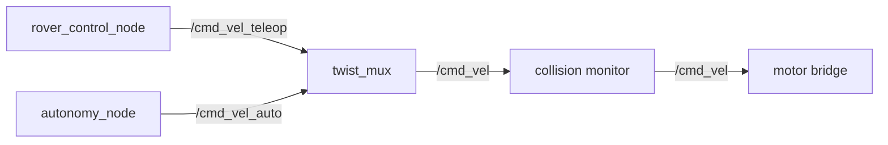
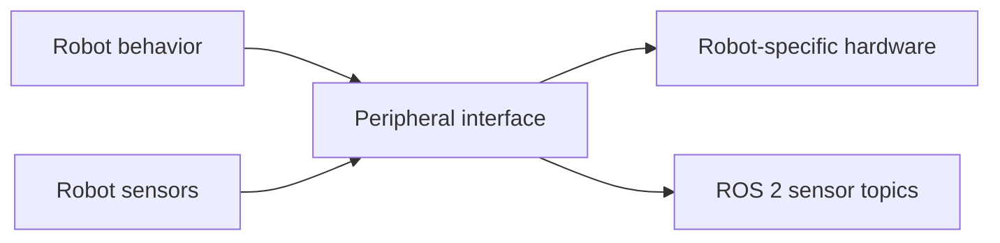

# Distributed ROS 2 Robotics Platform

A **distributed ROS 2 robotics platform** for building and controlling networked robots from a Steam Deck or similar Linux computer.

The project provides:

* Reusable ROS 2 interfaces for robotics control
* Template nodes for common robotics-control patterns
* A hardware-bridge architecture that separates ROS 2 behavior from robot-specific hardware
* Steam Deck-based robot control and visualization
* ESP32-based hardware integration
* A working four-wheel mecanum rover as the reference implementation

The goal is **not** to provide a universal robotics framework or a finished autonomous-robot stack.

Instead, this project establishes a reusable architecture and a set of working examples that can be adapted to different robots.

---

# Getting Started

If you want to try the platform on a Steam Deck, start with the **[setup guide](docs/install_guide.md)**. It takes you from a fresh system to a working ROS 2 robot computer, one step at a time:

* Installing Pixi and creating a ROS 2 Humble workspace
* Connecting the Steam Deck's gamepad
* Setting up Foxglove to visualize your robot
* Copying, renaming and editing the node templates for your own robot
* Starting everything from a desktop shortcut

Everything is installed inside your home folder, so SteamOS updates will not break it. The first install downloads a full ROS 2 environment, which takes several minutes.

The guide was written and tested on a Steam Deck. The Pixi and ROS 2 steps should carry over to other Linux computers, but the Steam-specific parts (the gamepad and the Foxglove container) may differ.

The platform does not include robot firmware, because that part is specific to each robot. The reference rover keeps its own firmware and its own quick-start guide in its own repository.

---

# Documentation

* [Setup guide](docs/install_guide.md): installing ROS 2, Pixi and Foxglove on a Steam Deck, and building a robot from the templates
* [Architecture and roadmap](docs/architecture-and-roadmap.md): the design and the roadmap in more detail
* [Controls](docs/controls.txt): how controller input becomes robot commands
* [Tools](ToolsReadme.md): the bring-up scripts and what each one does
* [Changelog](docs/changelog.md): what changed, and when

---

# Repository Layout

The main parts of the repository:

```text
.
├── docs/
│   ├── install_guide.md              Steam Deck setup guide
│   ├── architecture-and-roadmap.md   design notes and roadmap
│   ├── controls.txt                  controller input to robot commands
│   └── changelog.md                  dated list of changes
├── Node-templates/
│   ├── ros2/robot_template/          starting ROS 2 package: control node, motor bridge,
│   │                                 peripherals bridge and a launch file
│   └── desktop/robot-control.desktop desktop shortcut template
├── template_tools/                   generic bring-up scripts: wheel tests and controller mappers
├── ToolsReadme.md                    index of every tool
└── LICENSE
```

---

# What This Is

The basic idea is to keep **robot behavior and interfaces on the ROS 2 computer**, while allowing the actual robot hardware to be handled by separate microcontrollers and hardware-specific bridges.

```text
                    DISTRIBUTED ROS 2 PLATFORM
                              │
             ┌────────────────┴────────────────┐
             │                                 │
       STEAM DECK / ROS 2                ROBOT HARDWARE
             │                                 │
     ┌───────┴────────┐                  ESP32 / MCU
     │                │                  Motor drivers
  Templates       Reference nodes       Sensors / actuators
     │                │                       │
     └───────┬────────┘                       │
             │                                │
             └──────── Network / Bridge ──────┘
```

The Steam Deck acts as the robot's **ROS 2 computer**.

It handles things such as:

* Controller input
* Robot control logic
* ROS 2 interfaces
* Visualization
* Sensor processing
* Higher-level behaviors
* Future autonomy

The microcontroller handles the hardware-specific work:

* Motor control
* GPIO
* Sensors
* Servos
* Buzzers
* Hardware failsafes
* Low-level communication

This separation means the ROS 2 side does not need to know how a particular motor controller, GPIO pin, or microcontroller works.

---

# Why "Distributed"?

The system is distributed across multiple computing devices rather than putting the entire robot stack on a single controller.

For the reference rover:

```text
Steam Deck
    │
    │ ROS 2
    │
    ├── Controller input
    ├── Robot control
    ├── Command interfaces
    ├── Visualization
    └── Hardware bridges
             │
             │ Wi-Fi / UDP
             ▼
          ESP32
             │
       ┌─────┼─────┐
       ▼     ▼     ▼
    Motors  Sensors  Peripherals
```

The network boundary is therefore part of the architecture, but the platform does **not** require every robot to use the same network protocol.

ROS 2 interfaces are intended to be the reusable part.

Hardware protocols remain implementation-specific.

---

# Architecture

The project uses the current ESP32 mecanum rover as the **reference implementation** of the broader platform.

The important architectural boundary is:

```text
                 ROBOT PLATFORM
                       │
             ┌─────────┴─────────┐
             │                   │
        ROS 2 interfaces     Robot hardware
             │                   │
        behavior / commands    firmware
        sensor topics           drivers
        visualization           protocols
             │                   │
             └─────────┬─────────┘
                       │
                hardware bridge
```

The ROS 2 layer describes **what the robot should do**.

The hardware layer describes **how a particular robot actually does it**.

The bridges connect those two worlds.

---

# Reference Implementation

The platform is developed alongside a working robot: a four-wheel mecanum rover with an ESP32 controller, driven from a Steam Deck over Wi-Fi. It is the reference implementation, the first complete robot built on this architecture.

The rover lives in its own repository, with its own README and setup guide covering its hardware, firmware, network protocol, controls and ROS 2 packages. This repository stays focused on the platform: the architecture, the templates, the tools and the setup guide.

The rover's packages follow the same pattern the templates show: a control node, a motor bridge and a peripherals bridge.

---

# Hardware Bridges

A hardware bridge translates a ROS 2 interface into whatever a particular robot's hardware understands. For driving, a bridge subscribes to `/cmd_vel`, turns each velocity command into the robot's own drive commands, stops the robot if commands stop arriving, and sends a stop command when it shuts down. The templates in `Node-templates/` show this pattern for both a motor bridge and a peripherals bridge.

The bridge is intentionally robot-specific.

A different robot could use a different bridge:

```text
Mecanum robot
    → mecanum motor bridge

Differential robot
    → differential motor bridge

Tracked robot
    → tracked motor bridge

Servo robot
    → servo actuator bridge
```

All of these can expose the appropriate ROS-facing interfaces while implementing completely different hardware underneath.

This is one of the main architectural boundaries of the project.

The same pattern applies to non-drive hardware. A peripheral bridge handles things such as a servo head, a buzzer or sensor telemetry, and publishes sensor readings as ROS 2 topics.

A future robot can implement a different peripheral bridge without changing the overall architecture.

---

# Reusable ROS 2 Interfaces

A major design goal is to keep **ROS 2 interfaces stable while allowing hardware implementations to change**.

For example:

```text
/cmd_vel
```

means:

> Command the robot's base velocity.

It does **not** mean:

> Send this particular ESP32 UDP packet.

Likewise:

```text
/ultrasonic/range
```

describes a sensor observation rather than a particular HC-SR04 implementation.

This separation allows the hardware underneath an interface to change without forcing higher-level ROS 2 nodes to understand the hardware details.

---

# Templates

The repository contains generic node templates under:

```text
Node-templates/
```

These are **architectural starting points**, not complete universal hardware drivers.

They are intentionally free of assumptions such as:

* Robot IP addresses
* UDP port assignments
* GPIO assignments
* Motor-driver hardware
* Specific sensors
* Specific controller mappings

The templates demonstrate how a new robot can fit into the platform.

The reference rover packages then provide the working, hardware-specific implementations.

The [setup guide](docs/install_guide.md) shows how to copy the template package, rename it, edit the nodes and build it.

---

# Future Command Architecture

The current rover is primarily teleoperated.

The planned architecture separates teleoperation from autonomous behavior:



This is a **future architecture**.

The current rover does not yet have `twist_mux`, an autonomy node, or collision monitoring in the control path.

The important design rule is that autonomy should operate at the **ROS 2 command level**.

An autonomy node should not need to know about:

* UDP ports
* PWM
* GPIO
* ESP32 firmware
* Motor-driver implementation

It should produce a robot command through the same ROS 2 interfaces used by the rest of the platform.

---

# Peripheral Architecture

The same separation applies to non-drive hardware.



A robot may have:

* A servo head
* A camera
* LEDs
* A buzzer
* An arm
* A gripper
* An IMU
* Ultrasonic sensors
* LiDAR
* Wheel encoders

The ROS 2 layer should expose useful interfaces without requiring other nodes to know how those devices are physically connected.

---

# Roadmap

## 1. Core ROS 2 / Steam Deck Platform

**Status: Complete**

* ROS 2 Humble environment
* Steam Deck as robot computer
* Workspace and package structure
* Gamepad integration

## 2. Foxglove Integration

**Status: Complete**

* Foxglove Bridge
* ROS 2 topic visualization
* Steam Deck integration

A polished robot-specific sensor dashboard remains future work.

## 3. First ESP32 Robot

**Status: Complete**

* ESP32 firmware
* Wi-Fi connectivity
* OTA updates
* Robot hardware

## 4. UDP Robot Interface

**Status: Complete**

* Drive UDP channel
* Peripheral UDP channel
* Telemetry channel
* Hardware failsafes

## 5. Motor Control / Mecanum Drive

**Status: Complete**

* `/cmd_vel`
* Mecanum kinematics
* Four-wheel PWM output
* Minimum-PWM compensation
* Drive timeout

## 6. ROS 2 Teleoperation

**Status: Complete**

* Gamepad input
* Arcade mode
* Tank mode
* Mecanum strafing
* Deadman
* Turbo
* Mode switching

## 7. Peripheral Control & Telemetry

**Status: Complete**

* Head control
* Buzzer
* Ultrasonic range topic
* Raw telemetry
* Peripheral bridge

## 8. Head / Sensor Refinement

**Status: In Progress**

* Physical head calibration
* Sensor level calibration
* Sensor behavior refinement
* Telemetry improvements

## 9. Encoders & Odometry

**Status: Planned**

* Wheel encoders
* Wheel state
* Odometry
* `/odom`
* `/tf`
* `/joint_states`

## 10. Velocity Multiplexing / Autonomy

**Status: Planned**

* `twist_mux`
* Separate teleoperation and autonomy command sources
* Autonomous behavior node
* Mode management

## 11. Collision Monitoring

**Status: Planned**

* Sensor-aware velocity limiting
* Emergency stopping
* Hardware-independent collision layer

## 12. ROS 2 ↔ MQTT Integration

**Status: Planned**

MQTT will be used for **higher-level system integration**, rather than the real-time drive path.

Potential uses include:

* Home Assistant
* ESPHome
* Robot status
* Fleet state
* Higher-level commands

## 13. Multi-Robot Platform

**Status: Planned**

* Multiple robot namespaces
* Multiple hardware bridges
* Robot-specific configurations
* Shared autonomy infrastructure
* Fleet-level management

---

# Long-Term Architecture

The intended direction is to keep robot behavior, safety, and hardware implementation as separate layers.

```text
                    BEHAVIOR
                       │
          ┌────────────┴────────────┐
          │                         │
       TELEOP                    AUTONOMY
          │                         │
          └────────────┬────────────┘
                       ↓
                  /cmd_vel
                       ↓
               SAFETY / COLLISION
                       ↓
                ROBOT DRIVE API
                       ↓
              ROBOT-SPECIFIC BRIDGE
                       ↓
                    HARDWARE
```

The same principle applies to peripherals and sensors.

---

# What Is Reusable?

The project intentionally separates **platform concepts** from **reference-robot implementation**.

### Platform-level concepts

These are intended to be reusable:

* ROS 2 command interfaces
* ROS 2 sensor interfaces
* Hardware-bridge architecture
* Separation of behavior from hardware
* Template nodes
* Steam Deck as a ROS 2 robot computer
* Networked microcontroller architecture
* Future autonomy/safety command pipeline

### Reference-rover implementation

These currently belong specifically to the mecanum rover:

* Mecanum kinematics
* ESP32 firmware
* L298N motor control
* UDP ports `4210–4212`
* `FL,FR,RL,RR` packet format
* Head servo
* Buzzer
* Ultrasonic telemetry
* Current controller mappings

This distinction is intentional.

The rover is the first working robot built on the architecture, not the definition of the entire platform.

---

# Project Goal

The long-term goal is to make it possible to build different robots around a common ROS 2 architecture without forcing every robot to use the same hardware.

A future robot might be:

```text
ROS 2 / Steam Deck
        │
        ├── Teleoperation
        ├── Autonomy
        ├── Visualization
        └── Shared interfaces
                │
          Hardware bridge
                │
        ┌───────┴────────┐
        │                │
      ESP32            Other MCU
        │                │
     Rover A           Robot B
```

The software above the hardware bridge can remain largely consistent while the hardware implementation changes.

That is the core idea behind the platform:

> **Use ROS 2 to provide a common robotics interface, use templates to make that architecture easier to extend, and keep the actual hardware implementation specific to each robot.**

The current mecanum rover is the first complete implementation used to validate those boundaries.

---

# License

This project is released under the terms of the [LICENSE](LICENSE) file.
