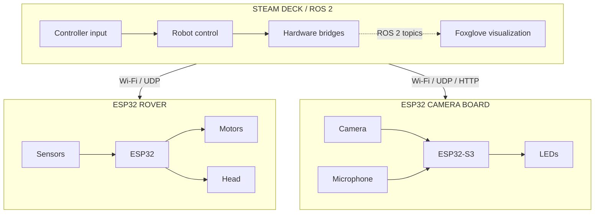
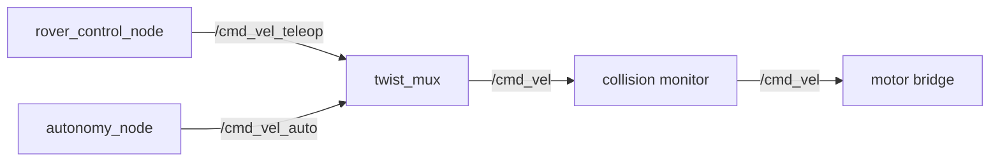
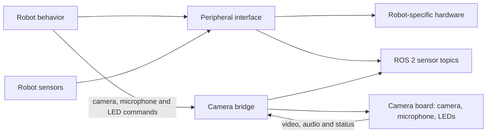

# Distributed ROS 2 Robotics Platform

A **distributed ROS 2 robotics platform** for building and controlling networked robots, using a **Steam Deck as the robot's main ROS 2 computer**.

The project provides:

* Reusable ROS 2 interfaces for robotics control
* Template nodes for common robotics-control patterns, including a camera board bridge
* A hardware-bridge architecture that separates ROS 2 behavior from robot-specific hardware
* Steam Deck-based robot control and visualization
* ESP32-based hardware integration
* A working four-wheel mecanum rover as the reference implementation

The goal is **not** to provide a universal robotics framework or a finished autonomous-robot stack.

Instead, this project establishes a reusable architecture and a set of working examples that can be adapted to different robots.

---

# Getting Started

If you want to try the platform on a Steam Deck, start with the **[setup guide](docs/install_guide.md)**. It takes you from a fresh system to a working ROS 2 robot computer, one step at a time:

* Installing Pixi and creating a ROS 2 Humble workspace
* Connecting the Steam Deck's gamepad
* Setting up Foxglove to visualize your robot
* Copying, renaming and editing the node templates for your own robot
* Starting everything from a desktop shortcut

Everything is installed inside your home folder, so SteamOS updates will not break it. The first install downloads a full ROS 2 environment, which takes several minutes.

The guide was written and tested on a Steam Deck. The Pixi and ROS 2 steps should carry over to other Linux computers, but the Steam-specific parts (the gamepad and the Foxglove container) may differ.

The platform does not include robot firmware, because that part is specific to each robot. The reference rover keeps its own firmware and its own quick-start guide in its own repository.

---

# Documentation

* [Setup guide](docs/install_guide.md): installing ROS 2, Pixi and Foxglove on a Steam Deck, and building a robot from the templates
* [Architecture and roadmap](docs/architecture-and-roadmap.md): the design and the roadmap in more detail
* [Controls](docs/controls.txt): how controller input becomes robot commands
* [Tools](ToolsReadme.md): the bring-up scripts and what each one does
* [Changelog](docs/changelog.md): what changed, and when

---

# Repository Layout

The main parts of the repository:

```text
.
├── docs/
│   ├── install_guide.md                Steam Deck setup guide
│   ├── architecture-and-roadmap.md     design notes and roadmap
│   ├── controls.txt                    controller input to robot commands
│   └── changelog.md                    dated list of changes
├── Node-templates/
│   ├── ros2/robot_template/            starting ROS 2 package: control node, motor bridge,
│   │                                   peripherals bridge and a launch file
│   ├── ros2/camera_template/           camera board bridge template: video stream to a ROS 2
│   │                                   image topic, with the hardware details left as placeholders
│   └── desktop/robot-control.desktop   desktop shortcut template
├── template_tools/                     generic bring-up scripts: wheel tests and controller mappers
├── ToolsReadme.md                      index of every tool
└── LICENSE
```

---

# What This Is

The basic idea is to keep **robot behavior and interfaces on the ROS 2 computer**, while allowing the actual robot hardware to be handled by separate microcontrollers and hardware-specific bridges.

```text
                 DISTRIBUTED ROS 2 PLATFORM
                              │
             ┌────────────────┴────────────────┐
             │                                 │
       STEAM DECK / ROS 2                ROBOT HARDWARE
             │                                 │
     ┌───────┴────────┐                  ESP32 / MCU
     │                │                  Motor drivers
  Templates       Reference nodes       Sensors / actuators
     │                │                        │
     └───────┬────────┘                        │
             │                                 │
             └──────── Network / Bridge ───────┘
```

The Steam Deck acts as the robot's **ROS 2 computer**.

It handles things such as:

* Controller input
* Robot control logic
* ROS 2 interfaces
* Visualization
* Sensor processing
* Higher-level behaviors
* Future autonomy

The microcontroller handles the hardware-specific work:

* Motor control
* GPIO
* Sensors
* Servos
* Buzzers
* Hardware failsafes
* Low-level communication

This separation means the ROS 2 side does not need to know how a particular motor controller, GPIO pin, or microcontroller works.

---

# Why "Distributed"?

The system is distributed across multiple computing devices rather than putting the entire robot stack on a single controller.

For the reference rover:



The network boundary is therefore part of the architecture, but the platform does **not** require every robot to use the same network protocol.

ROS 2 interfaces are intended to be the reusable part.

Hardware protocols remain implementation-specific.

---

# The Steam Deck as the Robot Computer

The platform uses a Steam Deck as the robot's main ROS 2 computer. That is an unusual choice, so it is worth being clear about why it works, what it makes easy, and where it has limits.

## Why a Steam Deck is versatile

A Steam Deck is a complete x86 Linux computer with a screen, a gamepad, Wi-Fi and a battery in one device. A single piece of hardware plays four roles at once:

| Role | What does the job |
|---|---|
| **Robot computer** | Runs the ROS 2 nodes, the hardware bridges and Foxglove's data bridge |
| **Controller** | The built-in gamepad, read through `joy_node` |
| **Dashboard** | Foxglove Studio on the built-in screen |
| **Development machine** | Desktop mode gives a full Linux environment for editing and testing |

Nothing has to be mounted on the robot except the microcontrollers that drive the hardware, so the robot itself can stay small, light and cheap.

Because everything above the hardware bridge is ordinary ROS 2, the same Steam Deck can drive a different robot just by running a different set of bridges.

## Pros of this layout

### Modularity

The robot is split into small parts that talk over a network: the ROS 2 computer, one or more microcontroller boards, and a bridge for each board.

* Adding a capability usually means adding **one more board and one more bridge**, without touching the parts that already work
* Each bridge can be written, tested and replaced on its own
* A new robot starts from the templates rather than from scratch

The reference rover shows this: the camera board, microphone and LED strip were added as a second ESP32 and a new bridge, and the drive code did not have to change. That is what makes the system **quite easy to keep building on**.

### Form factor

The handheld shape suits driving a robot.

* The controls, the screen and the computer are held in one hand
* There is no separate laptop, controller or monitor to set up
* The whole system can be picked up and taken to the robot
* The screen shows the Foxglove dashboard while you drive

### Power

A Steam Deck has far more processing power than a microcontroller, and enough to run a full ROS 2 desktop installation.

* It runs ROS 2 Humble, Foxglove and video decoding side by side
* There is headroom for heavier work later, such as autonomy and mapping
* The microcontrollers only have to do the real-time hardware work, so their firmware stays simple

### Replaceable parts

The ROS 2 interfaces stay the same while the hardware underneath changes. A different microcontroller or a different robot only needs a new bridge. The computer itself could also be swapped for any Linux machine that runs ROS 2.

### Nothing system-wide

Everything is installed in the home folder through Pixi, so a SteamOS update does not break the setup.

## Cons and limits

### It depends on the network

The computer and the robot are connected over Wi-Fi, so range, interference and delay all matter. The hardware failsafes live on the microcontrollers for this reason: the robot stops by itself if commands stop arriving.

### Video and audio share that link

A camera stream uses a lot of bandwidth next to the drive commands. How smooth the video stays while driving has not been measured yet.

### One computer is a single point of failure

If the Steam Deck goes to sleep, runs out of battery or crashes, the whole control side stops.

### It is not on the robot

The robot cannot run its own behaviors if the Steam Deck is out of range or switched off, so true onboard autonomy would need a computer on the robot.

### No real-time guarantees

Timing-critical work has to stay on the microcontrollers, because a general-purpose Linux system and Wi-Fi cannot promise exact timing.

### The links are not authenticated

The simple UDP connections are meant for a trusted home network, not an open one.

### It is a handheld, not a robot part

SteamOS has a read-only system and its own update cycle, and the battery has to last as long as the session.

## At a glance

| | Pros | Cons |
|---|---|---|
| **Structure** | Modular: add a board and a bridge without touching what works | More moving parts and more network links |
| **Hardware** | Handheld, with screen, controls and battery in one device | Not part of the robot; must stay in range and awake |
| **Computing** | Plenty of power for ROS 2, Foxglove and video | One computer is a single point of failure |
| **Network** | Simple to wire up: no cables between computer and robot | Wi-Fi delay, range and shared bandwidth |
| **Safety** | Failsafes on the microcontrollers stop the robot if commands stop | Links are not authenticated |

## Why the trade-off is accepted

These limits are accepted on purpose. The layout trades onboard computing for a robot that is simple to build, easy to extend and quick to get running.

The architecture also keeps the option open to move the ROS 2 computer onto a robot later. The bridges and ROS 2 interfaces would stay the same, because they never depended on where the computer sits.

---

# Architecture

The project uses the current ESP32 mecanum rover as the **reference implementation** of the broader platform.

The important architectural boundary is:

```text
                 ROBOT PLATFORM
                       │
             ┌─────────┴─────────┐
             │                   │
        ROS 2 interfaces     Robot hardware
             │                   │
        behavior / commands    firmware
        sensor topics           drivers
        visualization           protocols
             │                   │
             └─────────┬─────────┘
                       │
                hardware bridge
```

The ROS 2 layer describes **what the robot should do**.

The hardware layer describes **how a particular robot actually does it**.

The bridges connect those two worlds.

---

# Reference Implementation

The platform is developed alongside a working robot: a four-wheel mecanum rover with an ESP32 controller, driven from a Steam Deck over Wi-Fi. It is the reference implementation, the first complete robot built on this architecture.

The rover lives in its own repository, with its own README and setup guide covering its hardware, firmware, network protocol, controls and ROS 2 packages. This repository stays focused on the platform: the architecture, the templates, the tools and the setup guide.

The rover's packages follow the same pattern the templates show: a control node, a motor bridge and a peripherals bridge.

The rover also has a second ESP32, a camera board with a microphone and an LED strip, with its own bridge package on the Steam Deck. It is also where wheel odometry is being tried: that code is written and tested against simulated input, but the wheel encoders are not fitted yet.

---

# Hardware Bridges

A hardware bridge translates a ROS 2 interface into whatever a particular robot's hardware understands. For driving, a bridge subscribes to `/cmd_vel`, turns each velocity command into the robot's own drive commands, stops the robot if commands stop arriving, and sends a stop command when it shuts down. The templates in `Node-templates/` show this pattern for both a motor bridge and a peripherals bridge.

The bridge is intentionally robot-specific.

A different robot could use a different bridge:

```text
Mecanum robot
    → mecanum motor bridge

Differential robot
    → differential motor bridge

Tracked robot
    → tracked motor bridge

Servo robot
    → servo actuator bridge
```

All of these can expose the appropriate ROS-facing interfaces while implementing completely different hardware underneath.

This is one of the main architectural boundaries of the project.

The same pattern applies to non-drive hardware. A peripheral bridge handles things such as a servo head, a buzzer or sensor telemetry, and publishes sensor readings as ROS 2 topics.

A future robot can implement a different peripheral bridge without changing the overall architecture.

---

# Reusable ROS 2 Interfaces

A major design goal is to keep **ROS 2 interfaces stable while allowing hardware implementations to change**.

For example:

```text
/cmd_vel
```

means:

> Command the robot's base velocity.

It does **not** mean:

> Send this particular ESP32 UDP packet.

Likewise:

```text
/ultrasonic/range
```

describes a sensor observation rather than a particular HC-SR04 implementation.

This separation allows the hardware underneath an interface to change without forcing higher-level ROS 2 nodes to understand the hardware details.

---

# Templates

The repository contains generic node templates under:

```text
Node-templates/
```

These are **architectural starting points**, not complete universal hardware drivers.

They are intentionally free of assumptions such as:

* Robot IP addresses
* UDP port assignments
* GPIO assignments
* Motor-driver hardware
* Specific sensors
* Specific controller mappings

The templates demonstrate how a new robot can fit into the platform.

The reference rover packages then provide the working, hardware-specific implementations.

The [setup guide](docs/install_guide.md) shows how to copy the template package, rename it, edit the nodes and build it.

A second template, `Node-templates/ros2/camera_template`, covers a networked camera board: it turns the board's video stream into a ROS 2 image topic. Like the robot template it leaves the network address, ports and message formats as marked placeholders. Its own README explains what to edit.

---

# Future Command Architecture

The current rover is primarily teleoperated.

The planned architecture separates teleoperation from autonomous behavior:



This is a **future architecture**.

The current rover does not yet have `twist_mux`, an autonomy node, or collision monitoring in the control path.

The important design rule is that autonomy should operate at the **ROS 2 command level**.

An autonomy node should not need to know about:

* UDP ports
* PWM
* GPIO
* ESP32 firmware
* Motor-driver implementation

It should produce a robot command through the same ROS 2 interfaces used by the rest of the platform.

---

# Peripheral Architecture

The same separation applies to non-drive hardware.



A robot may have:

* A servo head
* A camera
* LEDs
* A buzzer
* An arm
* A gripper
* An IMU
* Ultrasonic sensors
* LiDAR
* Wheel encoders

The ROS 2 layer should expose useful interfaces without requiring other nodes to know how those devices are physically connected.

---

# Roadmap

## 1. Core ROS 2 / Steam Deck Platform

**Status: Complete**

* ROS 2 Humble environment
* Steam Deck as robot computer
* Workspace and package structure
* Gamepad integration

## 2. Foxglove Integration

**Status: Complete**

* Foxglove Bridge
* ROS 2 topic visualization
* Steam Deck integration

A polished robot-specific sensor dashboard remains future work.

## 3. First ESP32 Robot

**Status: Complete**

* ESP32 firmware
* Wi-Fi connectivity
* OTA updates
* Robot hardware

## 4. UDP Robot Interface

**Status: Complete**

* Drive UDP channel
* Peripheral UDP channel
* Telemetry channel
* Hardware failsafes

## 5. Motor Control / Mecanum Drive

**Status: Complete**

* `/cmd_vel`
* Mecanum kinematics
* Four-wheel PWM output
* Minimum-PWM compensation
* Drive timeout

## 6. ROS 2 Teleoperation

**Status: Complete**

* Gamepad input
* Arcade mode
* Tank mode
* Mecanum strafing
* Deadman
* Turbo
* Mode switching

## 7. Peripheral Control & Telemetry

**Status: Complete**

* Head control
* Buzzer
* Ultrasonic range topic
* Raw telemetry
* Peripheral bridge

## 8. Head / Sensor Refinement

**Status: In Progress**

* Physical head calibration
* Sensor level calibration
* Sensor behavior refinement
* Telemetry improvements

## 9. Camera, Microphone & LEDs

**Status: In Progress**

* Second ESP32 (a camera board) with its own firmware
* Video as `/camera/image/compressed`
* Microphone level and audio topics
* LED strip control topics
* Camera, light and microphone toggles on the gamepad (not yet confirmed on the real controller)
* Camera board heat and video smoothness still to be checked

## 10. Encoders & Odometry

**Status: In Progress**

* Firmware support for two rear wheel encoders (off until they are fitted)
* `/odom` and the `odom` to `base_link` transform, from a node that is written and tested against simulated input
* Encoders not yet fitted, so nothing is calibrated on the real robot
* `/joint_states` still planned

## 11. Velocity Multiplexing / Autonomy

**Status: Planned**

* `twist_mux`
* Separate teleoperation and autonomy command sources
* Autonomous behavior node
* Mode management

## 12. Collision Monitoring

**Status: Planned**

* Sensor-aware velocity limiting
* Emergency stopping
* Hardware-independent collision layer

## 13. ROS 2 ↔ MQTT Integration

**Status: Planned**

MQTT will be used for **higher-level system integration**, rather than the real-time drive path.

Potential uses include:

* Home Assistant
* ESPHome
* Robot status
* Fleet state
* Higher-level commands

## 14. Multi-Robot Platform

**Status: Planned**

* Multiple robot namespaces
* Multiple hardware bridges
* Robot-specific configurations
* Shared autonomy infrastructure
* Fleet-level management

---

# Long-Term Architecture

The intended direction is to keep robot behavior, safety, and hardware implementation as separate layers.

```text
                    BEHAVIOR
                       │
          ┌────────────┴────────────┐
          │                         │
       TELEOP                    AUTONOMY
          │                         │
          └────────────┬────────────┘
                       ↓
                  /cmd_vel
                       ↓
               SAFETY / COLLISION
                       ↓
                ROBOT DRIVE API
                       ↓
              ROBOT-SPECIFIC BRIDGE
                       ↓
                    HARDWARE
```

The same principle applies to peripherals and sensors.

---

# What Is Reusable?

The project intentionally separates **platform concepts** from **reference-robot implementation**.

### Platform-level concepts

These are intended to be reusable:

* ROS 2 command interfaces
* ROS 2 sensor interfaces
* Hardware-bridge architecture
* Separation of behavior from hardware
* Template nodes
* Camera board bridge template
* Steam Deck as a ROS 2 robot computer
* Networked microcontroller architecture
* Future autonomy/safety command pipeline

### Reference-rover implementation

These currently belong specifically to the mecanum rover:

* Mecanum kinematics
* ESP32 firmware
* L298N motor control
* UDP ports `4210–4215`
* `FL,FR,RL,RR` packet format
* Head servo
* Buzzer
* Ultrasonic telemetry
* Camera board, microphone and LED strip
* Wheel encoder odometry (not fitted yet)
* Current controller mappings

This distinction is intentional.

The rover is the first working robot built on the architecture, not the definition of the entire platform.

---

# Project Goal

The long-term goal is to make it possible to build different robots around a common ROS 2 architecture without forcing every robot to use the same hardware.

A future robot might be:

```text
ROS 2 / Steam Deck
        │
        ├── Teleoperation
        ├── Autonomy
        ├── Visualization
        └── Shared interfaces
                │
          Hardware bridge
                │
        ┌───────┴────────┐
        │                │
      ESP32            Other MCU
        │                │
     Rover A           Robot B
```

The software above the hardware bridge can remain largely consistent while the hardware implementation changes.

That is the core idea behind the platform:

> **Use ROS 2 to provide a common robotics interface, use templates to make that architecture easier to extend, and keep the actual hardware implementation specific to each robot.**

The current mecanum rover is the first complete implementation used to validate those boundaries.

---

# License

This project is released under the terms of the [LICENSE](LICENSE) file.
