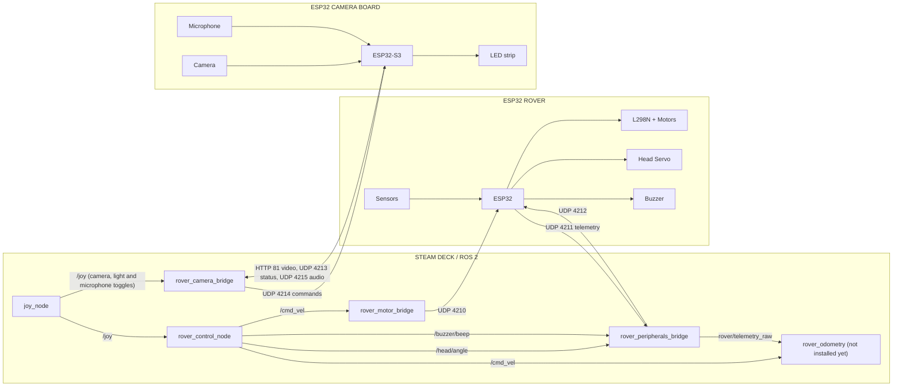
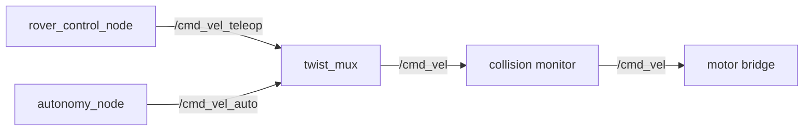
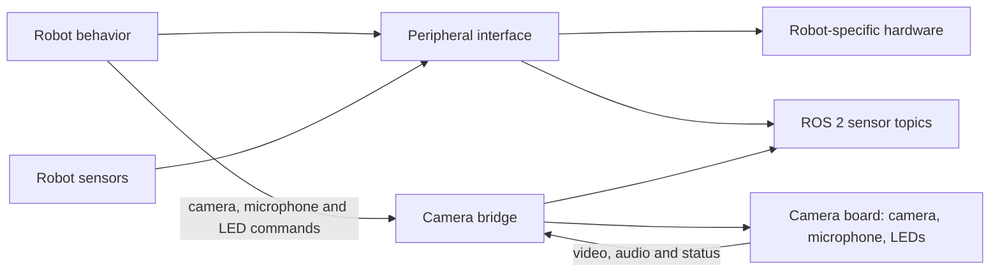

## Architecture

This project uses the current ESP32 mecanum rover as the **reference implementation** of a broader robot platform.

The important architectural boundary is:

```text
                 ROBOT PLATFORM
                       │
             ┌─────────┴─────────┐
             │                   │
        ROS 2 interfaces     Robot hardware
             │                   │
        behavior / commands    firmware
        sensor topics           drivers
        visualization           protocols
             │                   │
             └─────────┬─────────┘
                       │
                hardware bridge
```

The ROS 2 layer describes what the robot should do.

The hardware layer describes how a particular robot actually does it.

---

## Current Rover

The current reference robot is a four-wheel mecanum rover controlled by an ESP32.



This diagram represents the **current implementation**, not the future autonomous architecture.

---

# Node Responsibilities

## `rover_control_node`

Current responsibilities:

* Read `sensor_msgs/Joy`
* Implement arcade driving
* Implement tank driving
* Implement mecanum strafing
* Implement deadman behavior
* Implement turbo mode
* Toggle tank mode
* Implement proportional trigger drive (gas, brake, then reverse on the triggers), without a deadman
* Publish the active drive mode
* Generate head commands
* Generate buzzer commands

Current ROS interfaces:

```text
Subscribe:
    /joy

Publish:
    /cmd_vel
    /head/angle
    /buzzer/beep
    /drive_mode
```

The node is currently tightly coupled to the Steam Deck controller layout and the rover's available control modes.

The **architecture** is reusable, but this particular implementation should remain associated with the reference rover until another robot demonstrates a need for a generalized control package.

---

## `rover_motor_bridge`

Current responsibilities:

* Subscribe to `/cmd_vel`
* Apply mecanum kinematics
* Convert velocity to PWM values
* Apply minimum-PWM compensation
* Send drive packets to the ESP32
* Enforce a command timeout
* Send a stop packet during shutdown

Current hardware protocol:

```text
UDP 4210

FL,FR,RL,RR
```

The bridge is intentionally robot-specific.

A different robot should not necessarily reuse the mecanum implementation. For example:

```text
Mecanum robot
    → mecanum motor bridge

Differential robot
    → differential motor bridge

Tracked robot
    → tracked motor bridge

Servo robot
    → servo actuator bridge
```

They can all expose the same ROS-facing command interface while implementing different hardware below it.

---

## `rover_peripherals_bridge`

Current responsibilities:

* Send head commands
* Send buzzer commands
* Receive telemetry
* Publish ultrasonic range data
* Publish raw telemetry
* Publish line sensor topics (`/line_sensor/raw`, `/line_sensor/detected`, `/line_sensor/position`)

Current hardware protocol:

```text
UDP 4212
    HEAD,<angle>
    BUZZ,<hz>,<ms>

UDP 4211
    telemetry
```

This node demonstrates the platform's general peripheral-bridge pattern.

The actual implementation is rover-specific because it knows about the rover's head, buzzer, ultrasonic sensor, and telemetry format.

---

## `rover_camera_bridge`

Current responsibilities:

* Read the camera board's video stream and publish it as `/camera/image/compressed`
* Switch the camera on and off
* Publish microphone level and audio, and switch the microphone mode
* Control the LED strip (colour, mode, brightness, single pixels)
* Publish the camera board's status line
* Toggle the camera, lights and microphone from the gamepad D-pad

Current ROS interfaces:

```text
Publish:
    /camera/image/compressed
    /camera/enabled
    /microphone/level
    /microphone/audio
    /leds/state

Services:
    /camera/enable
    /microphone/enable
```

Current hardware protocol:

```text
HTTP 81   video stream
UDP 4213  status from the camera board
UDP 4214  commands: CAM, MIC, LED
UDP 4215  microphone audio
```

This bridge is rover-specific in the same way as the others. The gamepad toggles have not yet been confirmed on the real controller.

---

## `rover_odometry` (experimental)

Current responsibilities:

* Read wheel counts from the rover telemetry
* Use `/cmd_vel` to resolve direction and strafing
* Publish `/odom`, `/odometry/rear_wheel_speeds` and the `odom` to `base_link` transform

It is written and tested against simulated counts only. It is not installed on the Deck and the rear wheel encoders are not fitted, so it does nothing until the wheel size, counts per turn and wheelbase are set.

---

# Reusable Platform Interfaces

The platform should favor stable ROS interfaces over stable hardware protocols.

For example:

```text
/cmd_vel
```

means:

> Command the robot's base velocity.

It should not mean:

> Send this particular ESP32 UDP packet.

Likewise:

```text
/ultrasonic/range
```

describes a sensor observation rather than a specific HC-SR04 implementation.

This allows the hardware underneath those interfaces to change.

---

# Future Command Architecture

Autonomy should not directly control the motor bridge.

The planned architecture is:



This is a **future architecture**.

The current rover does not yet have `twist_mux`, an autonomy node, or collision monitoring in the control path.

The important design rule is that autonomy should operate at the ROS 2 command level. It should not know about:

* UDP ports
* PWM
* GPIO
* ESP32 firmware
* motor-driver implementation

---

# Peripheral Architecture

The same separation applies to non-drive hardware.



A robot may have:

* a servo head
* a camera
* LEDs
* a buzzer
* an arm
* a gripper
* an IMU
* ultrasonic sensors
* LiDAR
* encoders

The ROS layer should expose useful interfaces without requiring other nodes to know how those devices are physically connected.

---

# Templates

The repository contains generic node templates under:

```text
Node-templates/
```

These are architectural starting points rather than complete hardware drivers.

They deliberately omit:

* robot IP addresses
* UDP port assignments
* GPIO assignments
* motor-driver assumptions
* specific sensors
* specific controller mappings

The reference rover packages remain the working implementation.

A second template, `Node-templates/ros2/camera_template`, covers a networked camera board: it turns the board's video stream into a ROS 2 image topic. Like the robot template it leaves the network address, ports and message formats as marked placeholders. Its own README explains what to edit.

---

# Reference Rover Hardware

## Drive

Four-wheel mecanum drive using an X-pattern roller arrangement.

```text
FL ───────── FR
│             │
│   ROBOT     │
│             │
RL ───────── RR
```

Kinematics:

```text
fl = linear.x - linear.y - angular.z * wheel_separation / 2
fr = linear.x + linear.y + angular.z * wheel_separation / 2
rl = linear.x + linear.y - angular.z * wheel_separation / 2
rr = linear.x - linear.y + angular.z * wheel_separation / 2
```

## Reference UDP interfaces

```text
4210  Deck → Rover
      FL,FR,RL,RR

4211  Rover → Network
      Telemetry

4212  Deck → Rover
      HEAD,<angle>
      BUZZ,<hz>,<ms>
      RELEASE

4213  Camera board → Network
      Status line

4214  Deck → Camera board
      CAM,... | MIC,... | LED,...

4215  Camera board → Deck
      Microphone audio (only while the microphone streams)

HTTP 81  Camera board → Deck
      Video stream

(With the rear wheel encoders fitted, the 4211 telemetry also carries wheel counts.)
```

These are implementation details of the current rover, not platform-wide requirements.

## Camera board

A second ESP32, a Seeed XIAO ESP32-S3 Sense, carries the camera, a PDM microphone and a strip of seven addressable LEDs. Two IR sensors are planned for it. It has its own firmware and its own bridge, so the main rover board is not involved. The microphone is off by default.

---

# Roadmap

## 1. Core ROS 2 / Steam Deck Platform

**Status: Complete**

* ROS 2 Humble environment
* Steam Deck as robot computer
* Workspace and package structure
* Gamepad integration

## 2. Foxglove Integration

**Status: Complete**

* Foxglove Bridge
* ROS 2 topic visualization
* Steam Deck integration

A polished robot-specific sensor dashboard remains future work.

## 3. First ESP32 Robot

**Status: Complete**

* ESP32 firmware
* Wi-Fi connectivity
* OTA updates
* Robot hardware

## 4. UDP Robot Interface

**Status: Complete**

* Drive UDP channel
* Peripheral UDP channel
* Telemetry channel
* Hardware failsafes

## 5. Motor Control / Mecanum Drive

**Status: Complete**

* `/cmd_vel`
* Mecanum kinematics
* Four-wheel PWM output
* Minimum-PWM compensation
* Drive timeout

## 6. ROS 2 Teleoperation

**Status: Complete**

* Gamepad input
* Arcade mode
* Tank mode
* Mecanum strafing
* Deadman
* Turbo
* Mode switching

## 7. Peripheral Control & Telemetry

**Status: Complete**

* Head control
* Buzzer
* Ultrasonic range topic
* Raw telemetry
* Peripheral bridge

## 8. Head / Sensor Refinement

**Status: In Progress**

* Physical head calibration
* Sensor level calibration
* Sensor behavior refinement
* Telemetry improvements

## 9. Camera, Microphone & LEDs

**Status: In Progress**

* Second ESP32 (a camera board) with its own firmware
* Video as `/camera/image/compressed`
* Microphone level and audio topics
* LED strip control topics
* Camera, light and microphone toggles on the gamepad (not yet confirmed on the real controller)
* Camera board heat and video smoothness still to be checked

## 10. Encoders & Odometry

**Status: In Progress**

* Firmware support for two rear wheel encoders (off until they are fitted)
* `/odom` and the `odom` to `base_link` transform, from a node that is written and tested against simulated input
* Encoders not yet fitted, so nothing is calibrated on the real robot
* `/joint_states` still planned

## 11. Velocity Multiplexing / Autonomy

**Status: Planned**

* `twist_mux`
* Separate teleoperation and autonomy command sources
* Autonomous behavior node
* Mode management

## 12. Collision Monitoring

**Status: Planned**

* Sensor-aware velocity limiting
* Emergency stopping
* Hardware-independent collision layer

## 13. ROS 2 ↔ MQTT Integration

**Status: Planned**

MQTT will be used for higher-level system integration rather than the real-time drive path.

Potential uses:

* Home Assistant
* ESPHome
* Robot status
* Fleet state
* Higher-level commands

## 14. Multi-Robot Platform

**Status: Planned**

* Multiple robot namespaces
* Multiple hardware bridges
* Robot-specific configurations
* Shared autonomy infrastructure
* Fleet-level management

---

# Architectural Goal

The long-term architecture is:

```text
                    BEHAVIOR
                       │
          ┌────────────┴────────────┐
          │                         │
       TELEOP                    AUTONOMY
          │                         │
          └────────────┬────────────┘
                       ↓
                  /cmd_vel
                       ↓
               SAFETY / COLLISION
                       ↓
                ROBOT DRIVE API
                       ↓
              ROBOT-SPECIFIC BRIDGE
                       ↓
                    HARDWARE
```

The same principle applies to peripherals and sensors.

The current rover is the first implementation used to prove these boundaries. Future robots should reuse the ROS-facing architecture where appropriate while retaining their own hardware-specific bridges and firmware.
